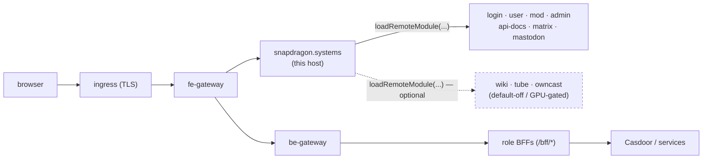

# snapdragon.systems — host shell

The **native-federation HOST shell** for a Snapdragon brand. This Angular 22
single-page app is the user-facing front door behind the gateway: it owns the
chrome (header / menu / footer / background, the accessible skip-link and the
shared profile modal), the authgate, the universal navigation, and the
role-home routing. It **exposes nothing** of its own feature surface — every
page under it is a separate repo loaded at runtime as a **native-federation
remote**. ✅ On `main` it mounts **nine** remotes via the data-driven
`REMOTE_ROUTES` table: login, user, mod, admin, api-docs, matrix, mastodon, plus
the **optional** services wiki, tube and owncast (tube/owncast are default-off and
GPU-gated; all three grey out via federation install-state when absent).

In the platform's two service tiers this sits in the **architecture tier**
(core, always present) alongside the gateways, Casdoor + PKI, and the
federation API. Each brand/domain runs its **own instance** of this host (one
container image, one nginx) wired to that brand's gateway, Casdoor issuer and
remotes.

---

## What it is

- **Stack:** Angular 22 standalone components + signals, `@angular-architects/native-federation`
  (`@softarc/native-federation-node`), Bootstrap 5, Vanta background. Built to a
  static bundle and served by nginx (`Dockerfile`, `nginx.conf`) or by the tiny
  Express fallback (`server.js`).
- **Role:** the federation **host/consumer** only. `federation.config.js` (via
  the shared `federation-base.js` helper) declares the host with **no `exposes`
  block** — it solely `loadRemoteModule(...)`s the remotes named in
  `src/assets/federation.manifest.json`. The shared-deps surface (Angular +
  RxJS singletons, `strictVersion`, the RxJS skip list) lives in
  `federation-base.js` so the host and remotes can't drift into a
  "shared is not a function" runtime break.
- **Boot order:** ✅ `src/main.ts` resolves the federation source **dynamic-first
  with a static floor** before Angular bootstraps in `src/bootstrap.ts`.
  `resolveFederationSource()` (`src/app/federation/federation-bootstrap.ts`) first
  fetches the DB-driven manifest `GET /api/federation/manifest` (federation-api,
  the `federation_modules` table) — attaching `Authorization: Bearer <bffToken>`
  when a `snap.session` is persisted (so an authenticated reload gets its
  domain/visibility-scoped overlay) and always sending `credentials: 'include'`.
  On success it returns the **union** of the bundled static manifest (the
  build-time floor — every baked remote) and the dynamic overlay (overrides
  matching slugs, adds new ones), so a successful read is never strictly worse than
  the static build. On **any** failure — the `401` an anonymous pre-login caller
  gets from the `authenticated()` endpoint, or network/5xx/parse/empty — it falls
  back to the **bundled static manifest** (`src/assets/federation.manifest{,.prod}.json`)
  so the shell always boots. The resolved value is fed to `initFederation(...)`,
  which maps each remote name → `remoteEntry.json` before bootstrap. Routing is
  **path-based** (no hash) so the host's paths line up with the fe-gateway
  prefixes and each remote's nginx.

The host keeps the original static marketing pages (`/home`, `/about`) as
public, unguarded routes; everything else is federated and gated.

---

## Where it sits — gateway, Casdoor, federation, multi-tenancy



The seven core remotes (login/user/mod/admin/api-docs/matrix/mastodon) are always
mounted; the three optional remotes (wiki/tube/owncast, dashed) are mounted but
**greyed-out via federation install-state** when the service is not deployed —
see *Capabilities / graceful degrade* below.

- **Gateways:** the host is the fe-gateway `/**` catch-all upstream. Its in-app
  paths (`/login`, `/social/matrix`, `/social/mastodon`, `/admin`, `/mod`,
  `/user`, `/admin/docs`) mirror the gateway path prefixes, and the **prod**
  federation manifest (`federation.manifest.prod.json`) points each remote at
  those same gateway-served paths (`/login/remoteEntry.json`, …).
- **Casdoor / session:** the host does **not** speak OAuth itself. The login
  remote completes the Casdoor flow and writes the canonical `snap.session`
  object to `localStorage`; `SessionService` (`src/app/session.service.ts`)
  reads it. That session carries the Casdoor `roles` plus the per-service
  tokens (`bffToken`, `matrix`, `mastodon`) and `registrationComplete`. The
  host and each remote each hold their own `SessionService` over the same
  storage key and stay in sync via a same-document `snap-session-change`
  broadcast and cross-tab `storage` events (so the login remote finishing
  registration immediately unlocks the host's social nav). ✅ For its typed
  calls the host wires `provideHttpClient` + a single
  `bearerInterceptor` (`src/app/http/bearer.interceptor.ts`): it sets
  `withCredentials: true` **always** and attaches `Authorization: Bearer
  <bffToken>` **opportunistically** — only when the session holds one and the
  request doesn't already set an `Authorization` header (never clobbering an
  explicit header, never sending an empty Bearer for an anonymous caller). This
  is the host's single Bearer/credentials seam; the legacy raw-fetch
  announcements service keeps its own `credentials: 'include'`. (Bearer tokens
  living in `localStorage` is a platform-wide security backlog item.)
- **Federation:** ✅ routes are loaded from remotes via `loadRemoteModule` —
  see `REMOTE_ROUTES` in `src/app/app.routes.ts`, the single declarative table
  of `path → remote name → exposed module → exported routes constant → guard`.
  The role-home remotes expose `./routes`; the wiki/tube/owncast remotes expose
  `./Wiki` / `./Tube` / `./Owncast` respectively.
- **Multi-tenancy:** this repo is brand-agnostic. Per-brand instances are
  provisioned from a handlebars-rendered repo (ArgoCD-reconciled), each pointed
  at its own gateway / Casdoor issuer / remote manifest. Domain scoping is
  enforced at the gateway and the role BFFs (issuer-keyed `DOMAIN_<x>`); the
  host only renders the role-gated chrome for the brand it was deployed into.

---

## Routes, role-gates and remotes

Routing is data-driven from `REMOTE_ROUTES` in `src/app/app.routes.ts`. Each
feature path is its own repo + nginx, mounted via `loadChildren →
loadRemoteModule(remote, './routes')`:

| Path | Remote | Guard | Gate |
|---|---|---|---|
| `/login` | `login` (`snapdragon-login-ui`) | — | public (the Casdoor login + registration flow) |
| `/user` | `user` (`snapdragon-user-ui`) | `userGuard` | any authenticated identity (the USER role-home; also exposes `./profile`) |
| `/mod` | `mod` (`snapdragon-mod-ui`) | `modGuard` | Casdoor `mod` role |
| `/admin` | `admin` (`snapdragon-admin-ui`) | `adminGuard` | Casdoor `admin` role |
| `/admin/docs` | `apidocs` (`snapdragon-api-docs`) | `adminGuard` | admin-only OpenAPI/API-docs console (listed **before** `/admin` so the more specific path wins) |
| `/social/matrix` | `matrix` (`snapdragon-matrix-ui`) | `registeredGuard` | requires full registration |
| `/social/mastodon` | `mastodon` (`snapdragon-mastodon-ui`) | `registeredGuard` | requires full registration |
| `/wiki` | `wiki` (`snapdragon-wiki-ui`, exposes `./Wiki`) | `wikiGuard` | optional service; `admin`/`superadmin`, or `mod` + per-service `ROLE_WIKI` |
| `/tube` | `tube` (`snapdragon-tube-ui`, exposes `./Tube`) | `tubeGuard` | optional, default-off, GPU-gated; `admin`/`superadmin`, or any holder of `ROLE_TUBE` |
| `/owncast` | `owncast` (`snapdragon-owncast-ui`, exposes `./Owncast`) | `owncastGuard` | optional, default-off, GPU-gated; `admin`/`superadmin`, or any holder of `ROLE_OWNCAST` (mods with `ROLE_OWNCAST` reach the moderation view) |

Guards live in `src/app/guards/` and read `SessionService`:

- **`roleHomeGuard`** — the default `''` route is a pure **authgate + role
  redirect**, no component of its own: anonymous → `/login`, otherwise → the
  signed-in user's role-home (`/admin` ▸ `/mod` ▸ `/user`). Role precedence
  `admin > mod > user` is computed in `SessionService.role()`.
- **`adminGuard` / `modGuard`** — gate `/admin` (+ `/admin/docs`) and `/mod` on
  the matching Casdoor role; everyone else is bounced to `/login`.
- **`userGuard`** — every authenticated identity is a baseline `ROLE_USER`, so
  this only blocks anonymous visitors.
- **`registeredGuard`** — Matrix/Mastodon are usable only after the login
  remote mints the per-service tokens (`registrationComplete === true`).
- **`wikiGuard`** — admits `admin`/`superadmin`, or a `mod` who also holds the
  per-service `ROLE_WIKI`; everyone else is bounced to `/login`. The wiki
  remote's own child guards then enforce the per-view `WIKI_READ`/`WRITE`/`MANAGE`
  boundary, and the BFF (`/bff/wiki/**` → `ROLE_WIKI`) is the real authorization.
- **`tubeGuard`** — admits `admin`/`superadmin`, or any identity holding
  `ROLE_TUBE` (a plain user with `ROLE_TUBE` can connect Google and browse their
  downloads). Backed by `/bff/tube/**` → `ROLE_TUBE` (admin routes
  `ADMIN`/`SUPERADMIN`).
- **`owncastGuard`** — admits `admin`/`superadmin`, or any identity holding
  `ROLE_OWNCAST` (a streamer reaches their own console; a `mod` with `ROLE_OWNCAST`
  reaches the moderation view). Backed by `/bff/owncast/**` → `ROLE_OWNCAST`
  (admin routes `ADMIN`/`SUPERADMIN`).

The **menu** (`src/app/menu/menu.component.ts`) mirrors these gates in the
chrome: a universal `Home | Mastodon | Matrix` menubar (Mastodon/Matrix
visible-but-disabled until fully registered) plus a profile dropdown whose
**Admin**, **API docs** and **Moderation** entries show only for the matching
role. The **profile modal** (`src/app/profile-modal/`) lazy-loads the user
remote's `./profile` editor via `loadRemoteModule('user', './profile')` and
applies the locked accessible-dialog contract (focus move/restore, focus trap,
Escape/backdrop dismiss).

---

## Host-owned features

Almost everything is delegated to remotes; the host shell itself owns only the
cross-cutting surface:

- **Authgate + role-home routing + universal nav + profile modal** (above).
- **Home announcements banner** (`src/app/announcements/`) — the logged-in home
  top banner. `AnnouncementsService` GETs the same-origin admin-bff endpoint
  **`/bff/announcements/home`** (routed `/bff/*` → BFF by the id-gateway, with
  the session cookie/JWT), renders only active, home-targeted announcements in
  server-supplied priority order, and supports **dismiss-once** (persisted to
  `localStorage`). Each announcement's server-sanitized `body_html` is rendered
  inside a **sandboxed null-origin `srcdoc` iframe** (no `allow-scripts`, no
  `allow-same-origin`) as a second line of defence — never via raw `innerHTML`.
  The banner is a labelled `aria-live="polite"` region.
- **Capabilities / graceful degrade** ✅ — `CapabilitiesService`
  (`src/app/capabilities/`) reads the **public** install-state endpoint
  `GET /api/federation/capabilities` (works anonymously; an unknown/failed read
  reports "nothing installed" rather than a dead link). The single predicate
  `installed(slug)` is consumed by the menu and the home-services cards so that
  absent/disabled **optional** services (matrix/mastodon/forum/games/tube/owncast/
  wiki) are **greyed-out with explain-why helptext**, never silently hidden.
- **Home-services launcher** ✅ (`src/app/home-services/`) — a data-driven,
  role + install-state-gated launcher-card grid mounted on the home page
  (`<div home-services>`). The `CARD_CATALOG` covers the optional services
  matrix/mastodon/forum/games (slug-gated) plus the core role-homes admin/mod
  (role-gated). Each card carries one of four `CardState` kinds, each with
  accessible helptext: `enabled` (a real link), `absent` (optional service not
  installed on this deployment), `role` (a role-gated card the principal lacks —
  "sign in as …"), and `registration` (an installed social service not yet fully
  registered — "complete your registration").
- **Account-status appeal-gate** ✅ (`src/app/account-status/`) — the
  `StatusGateComponent` (mounted in `app.component.html`) reads `GET /bff/me`
  via `AccountStatusService` and renders an assertive `role="alert"` banner
  **only** when the caller's own status is `suspended`/`banned` (it **fails open**
  to active on any error). The banner links to the appeal page
  (`APPEAL_ROUTE = '/login/appeal'`). 🚧 NOTE: the login-ui `/login/appeal`
  child route is still a deferred TODO on the login remote, so today the link
  resolves to the login surface rather than a dedicated appeal page.
- **Accessibility baseline** — a skip-link that moves focus (not just scroll)
  to `#maincontent` per WCAG 2.4.1, the WAI-ARIA menubar roving-tabindex
  pattern, and the modal dialog contract above.

---

## Build, deploy, CI

- **Local dev:** `npm run start-dev` (`ng serve`). The dev federation manifest
  (`federation.manifest.json`) points each remote at a `localhost:420x` port;
  run the remotes you need alongside the host.
- **Full stack:** `docker compose up -d` brings up the
  **snapdragon-id-gateway** (Spring Cloud Gateway, OAuth2 login client + JWT
  resource server) in front of this frontend, plus **Casdoor** (issuer) and a
  **Cassandra** keyspace (`snapdragon_systems_gateway`) for the gateway's
  revocation list / URL registry / resource-access cache. The frontend is not
  exposed directly — the gateway is the public entry point. See
  [`docs/games-stack-adoption.md`](docs/games-stack-adoption.md).
- **Container:** multi-stage `Dockerfile` builds the prod bundle and serves it
  from `nginxinc/nginx-unprivileged` on `:8080` with SPA `try_files` fallback.
- **CI:** GitLab (`.gitlab-ci.yml`) — the GitHub repo is pull-mirrored into the
  in-cluster GitLab, which builds + pushes this service's image to the
  in-cluster registry on push of the default branch / a tag. **No keys ship in
  the image** — key material is supplied from the operator key-USB at first
  boot. (GitHub Actions are intentionally not used.)

| Script | What |
|---|---|
| `npm run start-dev` | `ng serve` dev server |
| `npm run build` | production bundle (`public/snapdragon.systems/browser`) |
| `npm test` / `npm run coverage` | Karma/Jasmine unit tests (+ coverage) |
| `npm run e2e` | Nightwatch e2e (role authgate / nav / profile-modal suites) |
| `npm run dockerBuild` / `dockerRun` | build + run the container image |

---

## Layout

```
src/app/
  app.routes.ts            REMOTE_ROUTES table (9 remotes) + authgate/role-home + federationLoader
  session.service.ts       snap.session reader; role precedence (superadmin>admin>mod>user) + registration gate
  guards/                  roleHome · admin · mod · user · registration · wiki · tube · owncast
  federation/federation-bootstrap.ts  dynamic-first /api/federation/manifest + static-floor union/fallback
  http/bearer.interceptor.ts          withCredentials always + opportunistic Bearer (host HttpClient seam)
  capabilities/            CapabilitiesService — public /api/federation/capabilities install-state (grey-out)
  home-services/           data-driven launcher-card catalog (CardState: enabled/absent/role/registration)
  account-status/          StatusGateComponent — /bff/me suspended/banned appeal-gate banner (fail-open)
  menu/                    universal nav + role-gated profile dropdown (a11y menubar)
  profile-modal/           host modal mounting the user remote's ./profile editor
  announcements/           /bff/announcements/home banner (sandboxed srcdoc, dismiss-once)
  header/ footer/ background/ home/ about/   chrome + public marketing pages
src/main.ts                resolveFederationSource() → initFederation(source) → ./bootstrap
src/assets/federation.manifest{,.prod}.json  static FLOOR + fallback (remote name → remoteEntry URL)
federation.config.js + federation-base.js    host federation config (consumer; shared-deps surface)
```

## Related repos

Gateways `snapdragon-gateway` / `snapdragon-id-gateway` · identity **Casdoor** ·
federation `snapdragon-federation-api` + `snapdragon-remote-fragment` · the
remotes `snapdragon-{login,user,mod,admin}-ui`, `snapdragon-{matrix,mastodon}-ui`,
`snapdragon-{wiki,tube,owncast}-ui`, `snapdragon-api-docs` · role BFFs
`snapdragon-{user,mod,admin}-bff-api` · cross-realm sync `snapdragon-actions` ·
games stack `snapdragon.games`.

---

## Roadmap (planned / in-flight — NOT yet shipped)

These items are designed or in-flight at the platform level and would surface
through this host shell when they land. They are **not** in the code on `main`
today.

- 🔭 **Casdoor MFA (design-done, 9-PR plan).** WebAuthn + TOTP + recovery with
  `amr`/`acr` → `MFA_SATISFIED` and `gateway_route_access.mfa_required`
  (fail-closed) + BFF-driven step-up. This host would gain a future BFF-driven MFA
  challenge surface and step-up prompts for sudo / SSH-via-UI / superadmin ops.
  **No MFA challenge flow exists in the host today.**
- 🚧 **Notifications — external channels (in-flight).** Matrix DM / Akkoma feed /
  phpBB / email adapters on top of the shipped in-app MVP. The host currently
  renders only the announcements banner; external-channel prefs/silencing are
  future.
- 🚧 **Workload Console (in-flight).** A podman/OpenShift-like
  pod-management + live-log + exec federated admin-ui module that would appear as a
  future remote/route resolved through this host's dynamic manifest. **Not in
  `REMOTE_ROUTES` today.**
- 🔭 **Desktop app governance (design + queued).** Admin-curated Plasma Discover
  store + user install-requests + in-UI SSH terminal; any host-side launcher entry
  is future.
- 🚧 **Superadmin app-store — TAILNET-ONLY federated remotes.** The data layer is
  on `main` (in the admin-bff); the infra legs are in-flight. Future app-store
  remotes would be registered in the federation registry and resolved by this
  host's **dynamic manifest TAILNET-ONLY** (off the public UI). The dynamic-manifest
  mechanism is the shipped delivery path; the app-store remotes themselves are
  roadmap.
- 🚧 **Login appeal page.** The account-status appeal-gate already links to
  `/login/appeal`, but the login-ui appeal child route is still a deferred TODO on
  the login remote (so the link resolves to the login surface today).
