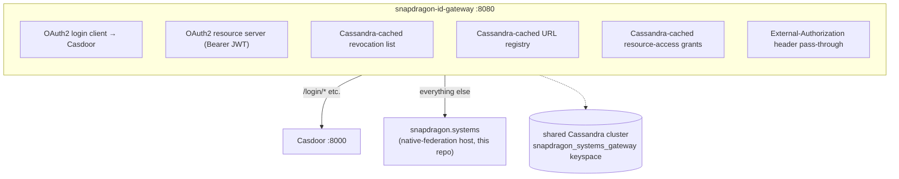

# Games-Stack Adoption

snapdragon.systems ships as part of the same multi-tier topology
as snapdragon.games: a platform gateway in front, Casdoor as the OAuth2
issuer, Cassandra for the gateway's revocation + URL-registry cache,
and the Angular **native-federation host shell** (this repo) as the
user-facing front door served behind the gateway. As of `main` this repo
is itself a federation **host** mounting nine remotes (see the
[README](../README.md)), the same shape as snapdragon.games — it is no
longer a monolithic single-page app.

## Topology



> Terminology note: the platform's runtime split is **fe-gateway** (the `/**`
> catch-all upstream that fronts this host) and **be-gateway** (which routes
> `/bff/*` to the role BFFs). `snapdragon-id-gateway` is the OAuth2 login client +
> JWT resource server used by the docker-compose dev stack here. The host actually
> calls the role-BFF surface (`/bff/me`, `/bff/announcements/home`, and the
> per-service `/bff/{wiki,tube,owncast}/**`) and the public federation API
> (`/api/federation/{manifest,capabilities}`).

## Differences from snapdragon.games

| Concern | snapdragon.games | snapdragon.systems |
|---|---|---|
| Gateway instance name | `snapdragon-games-gateway` | `snapdragon-id-gateway` |
| Cassandra keyspace | `threewizards` | `snapdragon_systems_gateway` |
| Casdoor organization | `threewizards` | `snapdragon-systems` |
| Frontend stack | Angular host + federated remotes | Angular native-federation host + 9 remotes (this repo) |
| Identity-layer responsibility | self-hosted player/mod/publisher | domain-scoped `superadmin > admin > mod > user` cascade |

Same patterns, same Cassandra cache shape, same Casdoor authority
converter. A JWT issued by either Casdoor instance is recognised
consistently across the platform because the
`casdoorAuthoritiesConverter()` code is identical in
[snapdragon-gateway](https://github.com/Snapdragon-Systems/snapdragon-gateway/),
[snapdragon-id-gateway](https://github.com/Snapdragon-Systems/snapdragon-id-gateway/),
and the snapdragon.games BFF.

## Role model

The platform's authoritative identity model is the domain-scoped least-privilege
cascade **`superadmin > admin > mod > user`**, enforced at the gateway and the
role BFFs (issuer-keyed `DOMAIN_<x>`) with per-domain namespace + mTLS isolation as
the cross-domain boundary. This host's `SessionService` recognises exactly those
roles (`isSuperadmin`/`isAdmin`/`isMod` + the baseline user; `role()` precedence
`admin > mod > user` drives the role-home redirect), plus per-service sub-roles
like `ROLE_WIKI`/`ROLE_TUBE`/`ROLE_OWNCAST`.

The games studio is a separate optional surface: games default to a
`games.<domain>` subdomain and instance creation is **superadmin-gated** via the
games app-store control plane (see the platform roadmap).

> ⚠ **Legacy / historical.** Earlier revisions of this doc described a
> platform-wide `game-master` role propagated by
> [snapdragon-actions](https://github.com/Snapdragon-Systems/snapdragon-actions/)
> (a 60 s Casdoor poll) into `admin` on snapdragon.games. **`game-master` is not a
> role this host recognises** — no guard or `SessionService` flag references it.
> This section is retained as historical design only; verify against
> `snapdragon-actions` before treating any `game-master → admin` propagation as
> current behaviour.

## Running locally

```bash
docker compose up -d
open http://localhost:8080/
```

First-time Casdoor seed credentials print to the container log:

```bash
docker compose logs casdoor 2>&1 | grep -A4 "Casdoor seed credentials"
```

## Production posture

The gateway's edge nginx (or a managed LB upstream) holds the public
edge cert from a publicly-trusted CA. The internal cert hierarchy
between services is chained from the snapdragon.systems root CA —
see
[snapdragon-gateway/docs/decisions/001-cert-chain-hierarchy.md](https://github.com/Snapdragon-Systems/snapdragon-gateway/blob/feature/snapdragon-games-gateway-alignment/docs/decisions/001-cert-chain-hierarchy.md).

snapdragon.systems is the canonical root: the cert chain script in
the gateway repo (`scripts/pki/build-chained-cert.sh`) takes this
root + key and emits a snapdragon-games intermediate signed by it.

## History: migration from the single-container topology (completed)

> This section is historical. The repo originally shipped a single nginx serving
> the Angular bundle on port 8080 with **no auth gate**, fronted by the gateway. That
> migration is **done**: on `main` the host has real route guards
> (`adminGuard`/`modGuard`/`userGuard`/`registeredGuard`/`wikiGuard`/`tubeGuard`/`owncastGuard`),
> calls the role BFFs (`/bff/me`, `/bff/announcements/home`, per-service
> `/bff/{wiki,tube,owncast}/**`) and the public federation API
> (`/api/federation/{manifest,capabilities}`) today. The "becomes auth-checked once
> the app starts calling `/api/*`" framing no longer describes future work — it is
> the current state.
